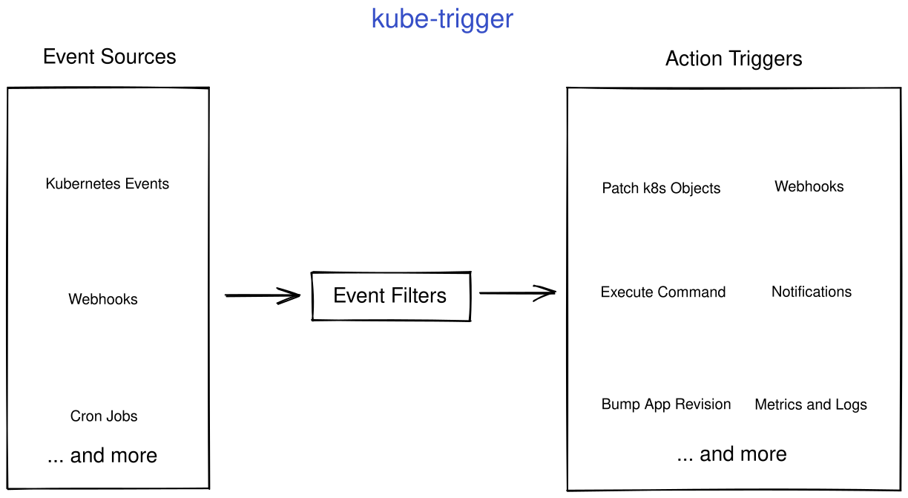

# kube-trigger

[](https://goreportcard.com/report/github.com/kubevela/kube-trigger)
[](/LICENSE)
[](https://github.com/kubevela/kube-trigger/releases)
[](https://codecov.io/gh/kubevela/kube-trigger)

[](https://github.com/kubevela/kube-trigger/actions/workflows/go-checks.yaml)
[](https://github.com/kubevela/kube-trigger/actions/workflows/unit-test.yaml)

kube-trigger watches for events and runs an action when one happens. You say what to watch, which events matter, and
what to do about them:

- a **Source** raises events, for example "a Deployment was updated" or "it is 2 a.m.";
- a **Filter** keeps the events you care about;
- an **Action** does something in response, such as patching a resource or starting a Job.

A Source, a Filter and an Action together are a **trigger**.



kube-trigger is part of [KubeVela](https://kubevela.io) but does not need it. Only the actions that work on KubeVela
Applications do.

## Contents

- [Quick start](#quick-start)
- [Install](#install)
- [Sources](#sources)
- [Filters](#filters)
- [Actions](#actions)
- [TriggerService](#triggerservice)
- [Configuration](#configuration)
- [Known limitations](#known-limitations)
- [Contributing](#contributing)

## Quick start

This trigger records when a ConfigMap was last changed: whenever `app-settings` is updated, it writes the time into
another ConfigMap, `settings-audit`. It needs a Kubernetes cluster and nothing else. Everything is in the `default`
namespace; if that is not your current namespace, add `-n default` to the `kubectl` commands.

1. Install kube-trigger, from a clone of this repository. See [Install](#install) for what these are.

   ```shell
   kubectl apply -f config/crd/
   kubectl apply -f config/manager/
   kubectl apply -f config/definition/
   ```

2. Create the two ConfigMaps.

   ```shell
   kubectl create configmap app-settings --from-literal=color=blue
   kubectl create configmap settings-audit
   ```

3. Create the trigger, which is [examples/triggerservice-audit-configmap.yaml](examples/triggerservice-audit-configmap.yaml):

   ```shell
   kubectl apply -f examples/triggerservice-audit-configmap.yaml
   ```

   ```yaml
   apiVersion: standard.oam.dev/v1alpha1
   kind: TriggerService
   metadata:
     name: audit-settings-changes
     namespace: default
   spec:
     triggers:
       - source:
           type: resource-watcher
           properties:
             apiVersion: v1
             kind: ConfigMap
             namespace: default
             events:
               - update
         filter: context.data.metadata.name == "app-settings"
         action:
           type: patch-resource
           properties:
             resource:
               apiVersion: v1
               kind: ConfigMap
               name: settings-audit
               namespace: default
             patch:
               type: merge
               data:
                 data:
                   lastChanged: $(context.timestamp)
   ```

   kube-trigger starts a worker for it, a Deployment with the TriggerService's name. Wait for it to be ready:

   ```shell
   kubectl rollout status deployment/audit-settings-changes
   ```

   The manager creates the Deployment a few seconds after the TriggerService. If the command says it is not found,
   run it again.

4. Change `app-settings` and look at `settings-audit`.

   ```shell
   kubectl patch configmap app-settings --type merge -p '{"data":{"color":"green"}}'
   kubectl get configmap settings-audit -o jsonpath='{.data}'
   ```

   ```
   {"lastChanged":"2026-11-27T22:08:22Z"}
   ```

Updating any other ConfigMap changes nothing: the filter drops the event. The worker's log shows each event and what
became of it:

```shell
kubectl logs deployment/audit-settings-changes
```

More examples are in [examples](examples).

## Install

### In a cluster

From a clone of this repository:

```shell
kubectl apply -f config/crd/
kubectl apply -f config/manager/
kubectl apply -f config/definition/
```

| Directory | What it installs |
| --- | --- |
| `config/crd/` | The `TriggerService`, `EventListener` and `Definition` CRDs. |
| `config/manager/` | The `vela-system` namespace, the manager that turns each TriggerService into a worker, and their RBAC. |
| `config/definition/` | The built-in [actions](#actions) and the worker template, as `Definition` objects in `vela-system`. |

Apply them in this order. The definitions live in `vela-system`, which `config/manager/` creates, so on a cluster
without KubeVela they cannot be applied first.

Both the manager and the workers are bound to `cluster-admin`. See [Known limitations](#known-limitations) before
installing this on a shared cluster.

### Standalone

kube-trigger can also run as a single process outside the cluster, reading its triggers from a file:

```shell
kube-trigger --config config.yaml
```

```yaml
# config.yaml
triggers:
  - source:
      type: resource-watcher
      properties:
        apiVersion: v1
        kind: ConfigMap
        namespace: default
        events:
          - update
    filter: context.data.metadata.name == "app-settings"
    action:
      type: patch-resource
      properties:
        resource:
          apiVersion: v1
          kind: ConfigMap
          name: settings-audit
          namespace: default
        patch:
          type: merge
          data:
            data:
              lastChanged: $(context.timestamp)
```

`--config` takes a `yaml`, `json` or `cue` file, or a directory, in which case every such file in it is loaded.

Standalone does not mean without a cluster. kube-trigger connects to the cluster in your kubeconfig, and reads its
actions from that cluster, so `config/crd/` and `config/definition/` must be applied there, in a `vela-system`
namespace. The manager is not needed.

To build the `kube-trigger` binary from source, see [CONTRIBUTING.md](CONTRIBUTING.md).

## Sources

### resource-watcher

Raises an event when a Kubernetes resource is created, updated or deleted.

```yaml
source:
  type: resource-watcher
  properties:
    apiVersion: apps/v1
    kind: Deployment
    namespace: default
    events:
      - update
    matchingLabels:
      tier: web
```

| Property | Required | Meaning |
| --- | --- | --- |
| `apiVersion` | yes | API version of the resource, e.g. `apps/v1`. |
| `kind` | yes | Kind of the resource, e.g. `Deployment`. Custom resources work too. |
| `namespace` | no | Watch one namespace. All namespaces when left out. |
| `events` | no | Any of `create`, `update`, `delete`. All three when left out. |
| `matchingLabels` | no | Watch only resources carrying all of these labels. |

A `create` event is raised only for resources created after kube-trigger started, not for those already there.

### cronjob

Raises an event on a schedule.

```yaml
source:
  type: cronjob
  properties:
    schedule: "0 2 * * *"
    timeZone: "UTC"
```

| Property | Required | Meaning |
| --- | --- | --- |
| `schedule` | yes | A five-field cron expression. |
| `timeZone` | no | The time zone the schedule is in, e.g. `UTC`. |

The event's `context.data` holds `schedule`, `timeZone` and `timeFired`. It is not a Kubernetes object, so there is no
`context.data.metadata` for an action to read. `patch-resource` works with it as it is; see
[examples/conf-cronjob.yaml](examples/conf-cronjob.yaml).

## Filters

A Filter is an expression over the event. The event is kept when it is true, and dropped otherwise. A trigger with no
filter keeps every event.

```yaml
filter: context.data.status.readyReplicas == context.data.status.replicas
```

Filters and Actions see the same `context`:

| Field | Contents |
| --- | --- |
| `context.sourceType` | The Source that raised the event, e.g. `resource-watcher`. |
| `context.event` | What happened, e.g. `{type: "update", cluster: "local"}` from the `resource-watcher`. |
| `context.data` | The object the event is about. On a delete, its last known state. |
| `context.changed` | What the event changed in `data`, as a [JSON merge patch](https://www.rfc-editor.org/rfc/rfc7386). Set only on a `resource-watcher` update. |
| `context.timestamp` | When the event was handled, in RFC 3339. |

A filter is written in [CUE](https://cuelang.org) or in [CEL](https://cel.dev).

### CUE filters

Any filter that is not a single `$( )` is CUE. Write it as an expression that gives `true` or `false`:

```yaml
filter: context.data.metadata.name =~ "^web-"
```

Write the test as an expression, as above. A filter written as a constraint on `context`, such as
`context: data: metadata: name: =~"^web-"`, does not filter anything at present
([#72](https://github.com/kubevela/kube-trigger/issues/72)).

### CEL filters

A filter that is a single `$( )` is a CEL expression. It reads the same `context`, and must evaluate to a bool:

```yaml
filter: $(context.data.status.readyReplicas == context.data.status.replicas)
```

Reading a field or map key that is not there is an error, which drops the event and is logged. Guard what only some
objects carry: `has(x.y)` tests field `y` of `x`, which must itself be there, and `"key" in m` tests a map key, including
keys such as `app.oam.dev/name`. CEL's `&&` and `||` skip what cannot change the result, so guards chain:

```yaml
filter: $(has(context.data.metadata.labels) && "tier" in context.data.metadata.labels && context.data.metadata.labels["tier"] == "web")
```

A CEL filter that does not compile stops kube-trigger at start, naming its trigger.

### Filtering on what changed

`context.changed` lets a Filter decide when to run from what changed. It holds only the fields that differ, with their
new values. A field that was removed, or set to `null`, is `null`; a merge patch cannot tell the two apart, so read
`context.data` to see which. A list that changed in any way appears whole.

In CUE, test a path with `!= _|_`. It is `false` when the path is not there, including on a create or delete where
`changed` is absent, so a trigger watching every event type needs no guard:

```yaml
# keep updates that changed the spec, skipping status-only writes
filter: context.changed.spec != _|_
```

```yaml
# keep updates that added, changed or removed any label
filter: context.changed.metadata.labels != _|_
```

To test a value, unify it rather than compare it: `==` on a path that is not there is an error, not `false`, so it
would log one for every update that did not touch the field.

```yaml
# keep updates where the phase became Running
filter: (context.changed.status.phase & "Running") != _|_
```

Test a map rather than a key inside it where the key may be removed: removing the only label drops the whole map, so
`changed` holds `labels: null` and `context.changed.metadata.labels.tier` is absent.

`metadata.resourceVersion` and `metadata.managedFields` change on every write, so `context.changed.metadata` is present
on every update; test the fields under it that you care about.

## Actions

An Action is what runs when an event passes the filter. It has a `type` and `properties`:

```yaml
action:
  type: patch-resource
  properties:
    resource:
      apiVersion: v1
      kind: ConfigMap
      name: my-cm
      namespace: default
    patch:
      type: merge
      data:
        data:
          foo: bar
```

Actions from one trigger run one at a time, in the order their events arrived.

### Built-in actions

| Type | What it does | Needs |
| --- | --- | --- |
| [`patch-resource`](#patch-resource) | Patches a Kubernetes resource. | |
| [`task`](#task) | Runs a container as a Kubernetes Job. | |
| [`bump-application-revision`](#bump-application-revision) | Makes KubeVela redeploy an Application. | KubeVela |
| [`record-event`](#record-event) | Appends the event to an `EventListener` object. | |
| [`create-event-listener`](#create-event-listener) | Creates the `EventListener` that `record-event` appends to. | |

#### patch-resource

| Property | Required | Meaning |
| --- | --- | --- |
| `resource.apiVersion`, `resource.kind` | yes | The resource to patch. |
| `resource.name` | yes | Its name. |
| `resource.namespace` | no | Its namespace. `default` when left out. |
| `patch.type` | no | `merge` (the default), `json` or `strategic`. |
| `patch.data` | yes | The patch: an object for `merge` and `strategic`, a list of operations for `json`. |

#### task

Creates a Job in the namespace of the object the event is about. The Job is owned by that object, so it is removed
with it.

```yaml
action:
  type: task
  properties:
    name: settings-changed
    image: busybox
    cmd: ["sh", "-c", "echo ${SOURCE_NAME} changed in ${SOURCE_NAMESPACE}"]
    ttlSecondsAfterFinished: 600
```

| Property | Required | Meaning |
| --- | --- | --- |
| `image` | yes | Image to run. |
| `cmd` | yes | Command to run in it. |
| `name` | no | Name of the Job and its container. The source object's name when left out. The Job is created in the source object's namespace. |
| `restart` | no | Restart policy, `Never` (the default) or `OnFailure`. |
| `ttlSecondsAfterFinished` | no | Seconds to keep a finished Job. |
| `env` | no | Extra environment variables, as a list of `name` and `value`. |

The container always gets `SOURCE_NAME` and `SOURCE_NAMESPACE`, the name and namespace of the source object.

#### bump-application-revision

Adds one to the `app.oam.dev/publishVersion` annotation of a KubeVela Application, which makes KubeVela deploy it again
as a new ApplicationRevision. With no properties, the Application is the one with the source object's name, in the
source object's namespace. `nameSelector` chooses another way:

```yaml
action:
  type: bump-application-revision
  properties:
    nameSelector:
      fromLabel: "watch-this"
```

| Property | Required | Meaning |
| --- | --- | --- |
| `namespace` | no | Namespace of the Applications. The source object's namespace when left out. |
| `nameSelector.fromLabel` | no | Bump the Application named by this label on the source object. |
| `nameSelector.matchingLabels` | no | Bump every Application that has these labels. |

A `nameSelector` takes one of `fromLabel` and `matchingLabels`; one with both, or with neither, is an error.

An Application must already carry the annotation, with a whole number as its value, as in
[examples/sample.yaml](examples/sample.yaml). One that does not is left as it is, without an error.

#### record-event

Appends the event, as the source object's reference, the event type and the time, to the `events` of an `EventListener`
object. The `EventListener` must already exist; `create-event-listener` makes one.

| Property | Required | Meaning |
| --- | --- | --- |
| `nameSelector.fromLabel` | no | Name of the `EventListener`, read from this label on the source object. The source object's name when left out. |
| `namespaceSelector.fromLabel` | no | Its namespace, read from this label. The source object's namespace when left out. |

#### create-event-listener

Creates an `EventListener` with the source object's name, namespace and labels, owned by the source object. It takes no
properties.

### Expressions in action properties

Action properties can hold `$( )` CEL expressions over the same `context` filters see, rendered for each event. An
expression that is a property's whole value keeps its type; one inside text is joined into it:

```yaml
action:
  type: patch-resource
  properties:
    resource:
      apiVersion: apps/v1
      kind: Deployment
      name: $(context.data.metadata.labels["app"])
      namespace: $(context.data.metadata.namespace)
    patch:
      type: merge
      data:
        metadata:
          annotations:
            last-trigger: $(context.event.type)-$(context.data.metadata.name)
```

A literal `$(` in action properties is written `$$(`. This matters for `$(VAR)`, Kubernetes' own syntax for a dependent
environment variable, and for shell substitution in a command, for example `["sh", "-c", "echo $$(date)"]`. An expression
that does not compile, including an unescaped `$(date)`, stops kube-trigger at start, naming its trigger and property.

Expressions in action properties are on by default, and can be turned off:

| Running | How to turn them off |
| --- | --- |
| A standalone kube-trigger | `--enable-cel-expressions=false` |
| One TriggerService | The annotation `trigger.oam.dev/cel-expressions: "false"` on it |
| Every TriggerService | The manager's `--enable-cel-expressions=false` |

The manager's `--require-cel-expression-opt-in` reverses the default: only TriggerServices annotated
`trigger.oam.dev/cel-expressions: "true"` render expressions. The annotation is read when the TriggerService's worker is
created, so set it before creating the TriggerService, or delete the worker Deployment to have it recreated.

### Writing your own action

An action is a [CUE](https://cuelang.org) template in a `Definition` object. `parameter` holds the action's properties
and `context` the event. The template does its work by calling a provider such as `kube.#Patch`, `kube.#Apply` or
`kube.#Get` from `vela/kube`.

```yaml
apiVersion: core.oam.dev/v1alpha1
kind: Definition
metadata:
  name: trigger-action-label-resource
  namespace: vela-system
spec:
  type: trigger-action
  templates:
    main.cue: |
      import "vela/kube"

      patch: kube.#Patch & {
        $params: {
          resource: {
            apiVersion: context.data.apiVersion
            kind:       context.data.kind
            metadata: {
              name:      context.data.metadata.name
              namespace: context.data.metadata.namespace
            }
          }
          patch: {
            type: "merge"
            data: metadata: labels: (parameter.key): parameter.value
          }
        }
      }

      parameter: {
        // +usage=The label to set on the object the event is about
        key: string
        // +usage=Its value
        value: string
      }
```

The Definition is named `trigger-action-<type>` and lives in `vela-system`. Once applied, it is used like any other:

```yaml
action:
  type: label-resource
  properties:
    key: seen-by-trigger
    value: "true"
```

The built-in actions in [config/definition](config/definition) are written the same way and are the best examples.

## TriggerService

In a cluster, triggers are given in a `TriggerService`:

```yaml
apiVersion: standard.oam.dev/v1alpha1
kind: TriggerService
metadata:
  name: my-triggers
  namespace: default
spec:
  triggers:
    - source: ...
      filter: ...
      action: ...
  worker:
    properties:
      config:
        logLevel: debug
```

For each TriggerService the manager creates, in the TriggerService's namespace:

- a ConfigMap with the TriggerService's name, holding its triggers;
- a worker Deployment with the same name, which runs them;
- a `kube-trigger` ServiceAccount for the worker, if there is none.

All three are removed with the TriggerService. Changing its triggers restarts the worker.

Do not give a TriggerService the name of a ConfigMap that already exists in its namespace: the manager uses a ConfigMap
of that name for itself ([#86](https://github.com/kubevela/kube-trigger/issues/86)).

`spec.worker.properties` adjusts the worker:

| Property | Default | Meaning |
| --- | --- | --- |
| `image` | `oamdev/kube-trigger:latest` | Worker image. |
| `serviceAccount` | `kube-trigger` | ServiceAccount the worker runs as. |
| `resource.cpu.requests`, `resource.cpu.limits` | `10m`, `500m` | CPU request and limit. |
| `resource.memory.requests`, `resource.memory.limits` | `64Mi`, `128Mi` | Memory request and limit. |
| `config` | | Worker settings. See [Configuration](#configuration). |
| `labels`, `annotations` | | Added to the Deployment and its pods. |

These are read when the worker is created. To apply a change to them afterwards, delete the worker Deployment and the
manager creates it again ([#74](https://github.com/kubevela/kube-trigger/issues/74)).

## Configuration

These settings tune how actions are run. Most installations do not need to change them.

Every setting is a command-line flag. Each can also be given as an environment variable: the flag's name in capitals,
with `-` as `_`. A flag on the command line wins over the environment, which wins over the default. For a worker in a
cluster, set the TriggerService field shown, which is read when the worker is created.

### Log Level

Frequently-used values: `debug`, `info`, `error`

Default: `info`

| CLI           | ENV         | TriggerService  |
|---------------|-------------|-----------------|
| `--log-level` | `LOG_LEVEL` | `.spec.worker.properties.config.logLevel` (`info` or `debug`) |

### Action Retry

Re-run Action if it fails.

Default: `false`

| CLI              | ENV            | TriggerService  |
|------------------|----------------|-----------------|
| `--action-retry` | `ACTION_RETRY` | Cannot be set for a worker |

### Max Retry

Max retry count if an Action fails, valid only when action retrying is enabled.

Default: `5`

| CLI           | ENV         | TriggerService                |
|---------------|-------------|-------------------------------|
| `--max-retry` | `MAX_RETRY` | `.spec.worker.properties.config.maxRetry` |

### Retry Delay

First delay to retry actions in seconds, subsequent delay will grow exponentially, valid only when action retrying is
enabled.

Default: `2`

| CLI             | ENV           | TriggerService                  |
|-----------------|---------------|---------------------------------|
| `--retry-delay` | `RETRY_DELAY` | `.spec.worker.properties.config.retryDelay` |

### Per-Worker QPS

Long-term QPS limiting per Action worker, this is shared between all watchers.

Default: `2`

| CLI                | ENV              | TriggerService                    |
|--------------------|------------------|-----------------------------------|
| `--per-worker-qps` | `PER_WORKER_QPS` | `.spec.worker.properties.config.perWorkerQPS` |

### Queue Size

Queue size for running actions, this is shared between all watchers

Default: `50`

| CLI            | ENV          | TriggerService                 |
|----------------|--------------|--------------------------------|
| `--queue-size` | `QUEUE_SIZE` | `.spec.worker.properties.config.queueSize` |

### Job Timeout

Timeout for running each action in seconds.

Default: `10`

| CLI         | ENV       | TriggerService               |
|-------------|-----------|------------------------------|
| `--timeout` | `TIMEOUT` | `.spec.worker.properties.config.timeout` |

### Worker Count

Number of workers for running actions, this is shared between all watchers.

Default: `4`

| CLI         | ENV       | TriggerService                   |
|-------------|-----------|----------------------------------|
| `--workers` | `WORKERS` | `.spec.worker.properties.config.workers` |

### Registry Size

Deprecated. It sized a cache of filters and actions that no longer exists, so it has no effect. The flag is still
accepted so existing command lines keep working, and will be removed in a later release.

| CLI               | ENV             |
|-------------------|-----------------|
| `--registry-size` | `REGISTRY_SIZE` |

### CEL Expressions

Render `$( )` CEL expressions in action properties, where a literal `$(` is written `$$(`. See
[Expressions in action properties](#expressions-in-action-properties). A filter that is a single `$( )` is CEL whatever
this is set to.

Default: `true`

| CLI                        | ENV    | TriggerService                                                            |
|----------------------------|--------|---------------------------------------------------------------------------|
| `--enable-cel-expressions` | `ENABLE_CEL_EXPRESSIONS` | `metadata.annotations["trigger.oam.dev/cel-expressions"]` (`"false"` opts out) |

## Known limitations

- **Everything runs as cluster-admin.** The manager and every worker are bound to `cluster-admin`. For each namespace
  with a TriggerService, the manager adds that namespace's `kube-trigger` ServiceAccount to the `kube-trigger`
  ClusterRoleBinding, and the entry stays there after the TriggerService is deleted. Anyone who may create a
  TriggerService can therefore act as a cluster admin through its actions.
- **A TriggerService has no status.** `kubectl get triggerservice` shows a name and an age. To see whether a trigger is
  running and what its events led to, read the worker's log.
- **Worker settings are read once.** `spec.worker.properties` and the CEL annotation take effect when the worker is
  created ([#74](https://github.com/kubevela/kube-trigger/issues/74)).
- **A CUE filter written as a constraint on `context` keeps every event**
  ([#72](https://github.com/kubevela/kube-trigger/issues/72)). Write filters as expressions.
- **A TriggerService must not share its name with a ConfigMap** in its namespace
  ([#86](https://github.com/kubevela/kube-trigger/issues/86)).

## Contributing

See [CONTRIBUTING.md](CONTRIBUTING.md). Planned work and known bugs are tracked in the
[issues](https://github.com/kubevela/kube-trigger/issues).
